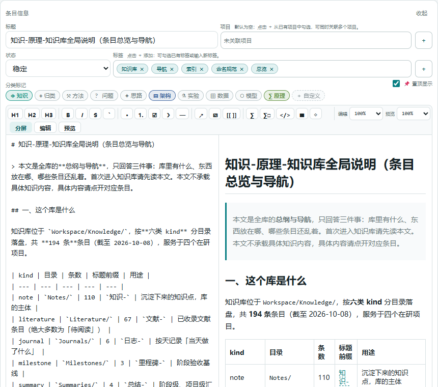

# 二、知识库条目

知识库是整个工作台的中心：**条目 = 一个 Markdown 文件**，落在 `Workspace/Knowledge/<KindDir>/<id>.md`，
文件头是 frontmatter（id / kind / title / status / 项目 / 标签…），下面就是正文。
界面、SQLite 索引、图谱、检索都是它的派生物——**改了文件，一切都会跟着变**；反过来，界面上改也会写回文件。

## 1. 七类条目：先选对类别

| 类别 | 目录 | 标题前缀 | 什么时候用它 |
| --- | --- | --- | --- |
| 灵感 idea | `Knowledge/Ideas/` | `灵感-` | 还没成形的念头、待验证的方向 |
| 研究日志 journal | `Knowledge/Journals/` | `日志-` | 当天流水：今天做了什么、遇到什么 |
| 笔记 note | `Knowledge/Notes/` | `知识-<类别>-` | **可复用的知识**：方法 / 模型 / 原理 / 架构 / 数据集（五选一） |
| 实验 experiment | `Knowledge/Experiments/` | `实验-` | 一次具体实验：口径、配置、结果、结论（名称要带编号） |
| 里程碑 milestone | `Knowledge/Milestones/` | `里程碑-` | 有验收条件的节点 |
| 工作总结 summary | `Knowledge/Summaries/` | `总结-` | 阶段收口 |
| 文献 literature | `Knowledge/Literature/` | `文献-` | 外部论文（有作者/年份/DOI 等字段，见[第四章](04-文献.md)） |

选型口诀：**一次可复现的做法 → 笔记·方法；可被建模/训练的对象 → 笔记·模型；机理与指标口径 → 笔记·原理；
分层与接口契约 → 笔记·架构；数据集本身及选型 → 笔记·数据集；一次具体实验记录 → 实验；未成形的念头 → 灵感。**

## 2. 新建与编辑

1. 进对应页面（如「笔记」），点列表上方的 **＋**；
2. 工作台立刻创建 `未命名<类别>` 并打开——**标题在编辑器里改**，没有命名弹窗；
3. 「条目信息」区（可点右上「收起」折叠）里改元数据；
4. 正文用 Markdown 写；
5. 点 **保存** 落盘。



编辑器几个要点：

- **工具栏**：H1/H2/H3、粗体/斜体/删除线、列表、引用、行内代码/代码块、链接、`[[ ]]` 互链、公式（`∑` 行内、`∑∑` 块级）、mermaid 图、图片、表格；右侧 `100%` 是缩放。
- **分屏 / 编辑 / 预览**：三档视图。分屏左边写、右边实时渲染（如上图）。
- **正文里的图片**：用工具栏插入，或写 ``。
- **保存** 按钮在底部；`↗ 打开原文件` 用系统默认编辑器打开这个 Markdown；`删除` 把它移进回收站。

## 3. 元数据：状态 / 标记 / 标签 / 项目

| 字段 | 作用 | 怎么改 |
| --- | --- | --- |
| **状态** | 每条目类型有自己的状态机（如笔记：待整理 / 整理中 / 稳定 / 已归档） | 条目信息区的下拉 |
| **标签** | 自由关键词，可多值；检索与图谱都吃它 | 输入框 + 回车；支持已有标签自动补全 |
| **分类标记** | 10 个内置标记（知识 / 归类 / 方法 / 问题 / 思路 / 架构 / 实验 / 数据 / 模型 / 原理）+ 自定义 | 点徽章开关；`+ 自定义` 可加自己的标记 |
| **项目** | 归属到一个或多个项目；也可以**不归属**（通用基础） | 「项目」输入框，或点 **+** 从已有项目里勾选 |
| **置顶** | 在列表里排最前 | 勾「置顶显示」 |
| **记录日期** | 日志/总结/实验等按此字段排序与聚合 | 对应的日期输入 |

> **「未归属项目」是合法且有意义的**：跨项目通用的基础知识（如某条评测口径）就让它空着，并打上「通用基础」标签。

## 4. 命名规范（硬约束，不合规会被拒写）

标题结构固定为 `<前缀>-<类别>-<名称>`，其中「类别」只有 **note（笔记）** 用，且必须从
**架构 / 方法 / 模型 / 原理 / 数据集** 里选**恰好一个**：

```text
灵感-用扩散模型做弱小目标数据增广
日志-20261010
知识-方法-小区域滤波（SR）
知识-原理-小目标检测评测指标体系
实验-多模型基线对照（2.2）
里程碑-阶段2验收
总结-阶段2收口
文献-Onboard observer-enhanced filter ...
```

要点与常见错误：

- **实验条目必须带编号**（`（2.2）` 这种），便于按序号排序与交叉引用；
- 标题里**禁用** `《》[]`；长度有上限（超长会 warn）；
- 笔记**必须**有且仅有一个类别词，`知识-方法-小区域滤波` ✅、`知识-小区域滤波` ❌；
- 改标题请**在界面里改**（会同步正文首个 H1 与全库交叉引用），不要手改文件。

## 5. 互链与关系层

- 正文里写 `[[知识-方法-小区域滤波（SR）]]` 就是一条**互链**，编辑器工具栏有插入按钮；
- 条目详情里能看到**反向链接**（谁引用了我），图谱页的边也来自这里；
- 关系层支持语义化关系段（如「前置底账」「后续实验」「方法条目」），写在同一节里即可被解析；
- 引用不存在的标题 = 断链，`python -m core.doctor` 会报出来——**这是提醒你去补那条条目**。

## 6. 删除与回收站

点编辑器里的 **删除** → 条目文件被移到 `Workspace/System/Trash/<kind>/`（文件名前加时间戳），
索引与图谱同步移除。**回收站里的文件不会自动清**，要恢复就把它移回原目录并重建索引
（设置 → 服务与存储 → 重建索引，或 `python -m core.index.maintain`）。

## 7. 本章常见问题

| 现象 | 原因与处理 |
| --- | --- |
| 保存后列表没变 | 列表按「更新」排序；确认已保存（按钮变回可用态），必要时刷新页面 |
| 标题报错不让保存 | 违反命名规范（第二章第 4 节）；按提示改前缀/类别词/编号 |
| 手改文件后界面不认 | 索引有指纹，改动会被自动发现；若没生效，设置里重建索引 |
| 想批量改格式 | **别批量重写**——用界面逐条改，或写脚本调 `kb_*` 工具，保证命名与交叉引用同步 |
