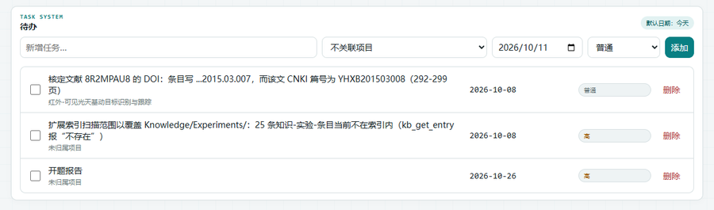
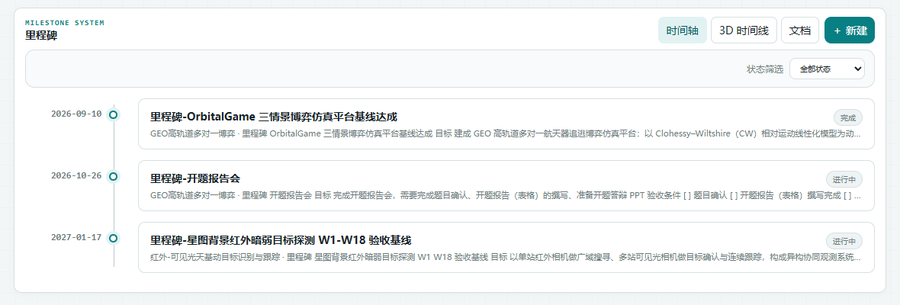

# 六、项目、待办与里程碑

## 1. 项目：把研究拆成有目录的单元

**建项目**：概览 → 「项目推进」卡 → **新建项目** → 输入名称。
工作台自动创建七个标准子目录并登记项目：

```text
Workspace/Projects/<项目名>/
├─ Notes/         过程笔记、会议记录
├─ Experiments/   实验脚本与配置
├─ Data/          原始数据（大文件放这里，注意体积）
├─ Results/       结果表格/日志/中间产物
├─ Figures/       出图
├─ Manuscript/    稿件（含 .bib 引用）
└─ References/    参考资料
```

**项目怎么用**：

- 条目（笔记/实验/文献/里程碑…）都能关联到项目（编辑器「项目」字段，支持多项目）；
- 概览的「项目推进」卡按项目汇总：条目数、未完成待办、近期里程碑；
- 项目记录页（`/api/project-records`）给出每个项目的状态、最近更新、文档数；
- 项目本身也有状态（进行中 / 暂停 / 完成 / 归档），在项目记录里维护。

> 跨项目通用的知识（某条评测口径、某个方法的原理）**不要**硬塞进项目：让它「未归属」并打「通用基础」标签，
> 这样它既不会被算进某个项目的进度，又能被所有项目引用。

## 2. 待办：今天/本周要干的事

侧栏「核心工作 → 待办」：



- **新增**：输入标题 → 选**项目**（可不选）→ 选**优先级**（高/普通/低）→ 点 **添加**；
- **列表**：未完成在前，按截止日期与优先级排序；勾选即完成；
- **截止日期**：条目上可设 `due`，逾期会标红——这也是**顶栏到期角标**（插件提供）的数据源；
- **完成 ≠ 删除**：完成的待办保留在列表里可回看，活动日志里也会记一条「完成任务」。

**用法建议**：待办只放**可执行动作**（"跑 3.1 的对照实验"），知识沉淀放条目（"实验 3.1 的记录"），
两者用项目关联起来即可在概览上对齐。

## 3. 里程碑：有验收条件的节点

侧栏「研究 · 知识 → 里程碑」：



三种视图（右上切换）：

| 视图 | 用途 |
| --- | --- |
| **时间轴** | 按日期铺开，看阶段节奏与依赖顺序 |
| **3D 时间线** | 空间化展示（节点高低/前后代表阶段与权重），适合汇报与总览 |
| **文档** | 左侧列表 + 右侧编辑器，就是里程碑条目的正文编辑 |

**里程碑条目要有**：目标、**验收条件**（可判定的，如"mIoU ≥ 0.75 且虚警 ≤ 1e-5"）、
依赖的前置实验、截止日期（`due`）。到期提醒同样走顶栏角标。

## 4. 三者怎么配合（推荐节奏）

1. **阶段开始**：建 1–2 个里程碑（写清验收条件），把要做的事拆成若干待办并关联项目；
2. **每天**：待办页勾掉完成的；随手写日志/灵感；实验结束就写一条实验条目并把结果贴进去；
3. **每周**：用 Agent 或手工写一条工作总结，引用本周的实验与笔记（互链）；
4. **阶段收口**：里程碑打勾（状态改「完成」），跑一次 `python -m core.doctor` 看有没有断链与命名漂移；
5. **要交付时**：文献页导出 BibTeX，报告导出走插件（设置里启用「报告导出」）。

## 5. 本章常见问题

| 现象 | 处理 |
| --- | --- |
| 项目删不掉 | 项目里还有条目/待办关联：先把它们改到别的项目或取消归属 |
| 里程碑不在时间轴上 | 缺 `due`（截止日期）或 `record_date`；补上即可 |
| 待办列表看不到某项目 | 待办页没有项目筛选时全量显示；用搜索框过滤项目名 |
| 想给项目加自定义目录 | 文件夹页新建目录即可；标准七目录只是初始骨架，不限制你扩展 |
