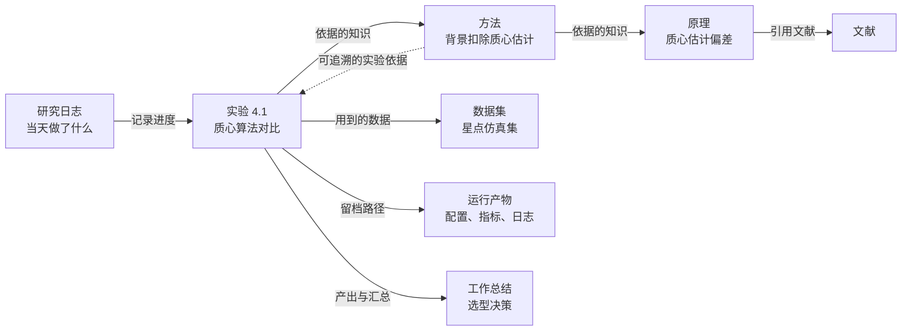

# 研究记录、实验归档与知识检索方案

研究日志保留每日时间线，实验条目保存可复查的结果，知识条目沉淀可复用的方法、原理和结论。RAG 按问题选择来源，项目视图通过双链把这些条目串起来。方案沿用现有条目类型和目录，检索排序及专用视图是后续产品改动。

## 条目怎么记

| 入口 | 只在这里维护的内容 | 建条目时机 |
| --- | --- | --- |
| 研究日志 | 今天推进了什么、遇到什么阻塞、下一步以及相关条目的链接 | 每天记录，按工作事项链接实验、知识或文献 |
| 实验 | 研究问题、对照组、配置、数据与指标口径、结果、失效模式及归档路径 | 有独立研究问题或一组需要共同解释的对照结果时建一条 |
| 知识库（沿用 `note`） | 一条方法的步骤和适用条件，或一个原理的定义、推导和假设。条目带证据来源和适用边界 | 发现一个可独立查找或跨实验复用的问题时创建或更新 |
| 文献 | 外部论文的结论、出处、对应页码或章节 | 需要记录外部证据时 |
| 工作总结 | 阶段决策、采纳理由和待解决事项，链接对应的实验和知识 | 阶段收口时 |

建议工作台把侧栏「笔记」改为「知识库」，提供「方法 / 原理 / 模型 / 架构 / 数据集」与状态、项目筛选。继续使用现有分类标记和 `知识-<类别>-<名称>` 标题。通用知识按现行约定留空 `projects` 并标记 `通用基础`，项目通过引用使用它。零散观察先留在日志，未成形的设想记在灵感，待整理的知识条目使用「草稿」或「整理中」。

例如，`知识-原理-质心估计偏差` 记录背景梯度为什么影响估计，`知识-方法-背景扣除质心估计` 记录如何估计背景、如何计算质心及方法在哪些条件下有用。实验记录实际使用的版本、设置和观测结果。方法条目更新时，旧实验仍以当时的代码提交、配置快照和数据版本为准。

## 一项工作的关系图



图中的箭头表示从条目点到什么。实验按现有正文小节写「依据的知识」「用到的数据」「引用文献」「同系列实验」「产出与汇总」。日常记录用 `[[<id>]]` 链接当天涉及的条目。知识正文可以在「关联」下加「验证记录」，链接具体实验并写清支持、反例或证据不足的范围。现有索引会将「验证记录」视为通用链接，界面可展示正文中的证据说明。产物路径打开项目文件，属于文件入口。条目的创建、更新和改名沿用 `kb_*` 写入入口。

项目页可用同一份数据提供三种查看方式。

- **按日期**展开研究日志，每天可点开对应的实验、知识和后续事项。
- **按实验**列出系列、状态、数据版本、结果和文件入口。点开单条实验后展示配置、结论与相关知识。
- **按知识**选择一个方法或原理，显示一跳关系，并允许展开两跳。将「哪些实验用过此方法」和「哪些结果支持或限制此方法」分别呈现。使用关系本身只证明该方法被采用过。

## 实验怎么存

实验的检索入口在 `Workspace/Knowledge/Experiments/<entry-id>.md`，实际文件按项目放在 `Workspace/Projects/<项目名>/Experiments/<entry-id>/`。用条目稳定 ID 绑定两处，显示编号继续遵循实验标题命名规则。建议在实验「留档路径」中记录 Workspace 相对路径，以便在同步设备上定位。

```text
Projects/<项目名>/Experiments/<entry-id>/
  runs/<run-id>/
    config.yaml
    metrics.csv
    run.log
    outputs/
```

同一对照设计内换种子、重复运行或执行预定的参数组时，新增 Run 目录，在实验正文保留对照表及关键 Run 编号。更换研究问题或另立一组需独立解读的对照时，新建实验条目，用「同系列实验」连接。实验最低限度保留数据版本、代码提交或环境版本、关键参数、指标口径、结果、异常与对应输出路径。大型数据和模型可引用已登记的版本化位置，实验条目保留定位信息。跨日完成的同一实验可以由多篇日志链接。

## RAG 应当引用什么

目前独立的 RAG 索引会读取条目 Markdown 正文，PDF 全文为可选项，搜索支持按 `kind` 筛选。「知识优先、按类型取证」是建议的检索策略。可以先使用现有条目和双链建立样本，验证来源分工，再调整检索。

| 问题 | 首选来源 | 回答中应带出的证据 |
| --- | --- | --- |
| 怎么做、为什么、适用于什么条件 | 稳定的知识条目，优先匹配当前项目及相关通用知识 | 方法或原理的章节、适用范围、关联实验或文献。仅有草稿时注明状态 |
| 某种方法在本项目是否有效 | 相关实验的「数据与口径」「结果」「结论与失效模式」 | 指标值、对照条件、版本、实验编号或 Run 编号。保留在有效条件下得到的反例 |
| 某天做了什么、为什么调整方案 | 研究日志和工作总结 | 日期、记录中的决策理由以及关联证据 |
| 论文原话或报告了什么 | 文献条目及可用的 PDF 全文 | 题名与章节或页码。只有题录时说明可引用范围 |

默认知识问答可从「稳定」知识条目开始，沿显式链接补充最相关的实验和文献。实验结果、阶段进度、外部文献问题走相应入口。日志、灵感与草稿继续支持主动搜索。对于量化结论，引用实验或原始文献中的数值与条件。只找到总结或日志中的转述时，按转述标明来源。知识中的经验性结论在标为「稳定」前需经人工确认，并链接能支持该结论及其适用范围的实验或文献。试运行后可按 Markdown 小节切片，保留条目 ID、章节与项目等信息，方便引用回跳。

## 小范围试行

1. 选一个实验系列，串起一篇现有日志、一条实验、一条方法及其原理。只在原条目中补缺失的链接和归档路径。
2. 用三个问题走查同一组内容。「如何估计质心」应先找到方法。「哪组数据上的结果支持它」应回到实验的条件和指标。「当天做了什么」应从日志进入同一实验。
3. 先复用现有列表和知识图谱。需要独立入口时，在项目页增设关系视图，再落实 Agent 的来源筛选及证据回跳。以三类问题都能打开原条目或实验产物为验收条件。
